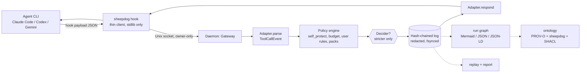
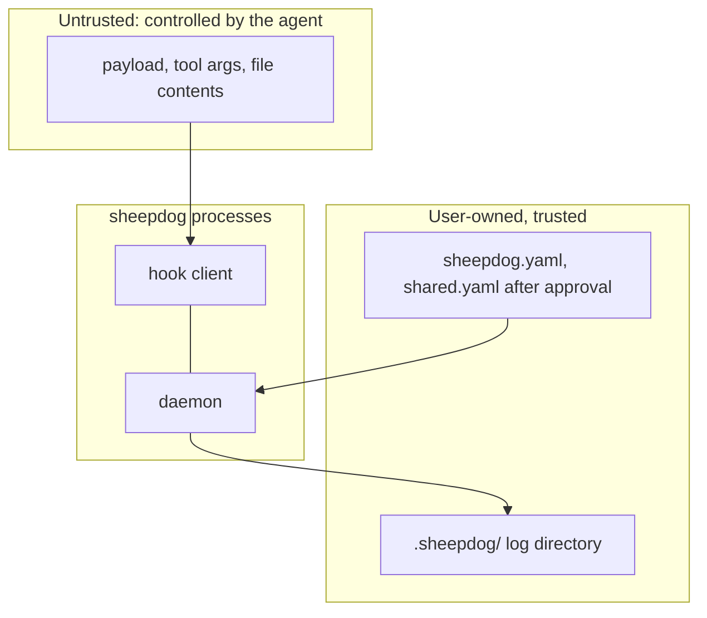

# Architecture

## Data flow of one tool call

1. The agent CLI is about to run a tool and starts `sheepdog hook <cli>`, writing the payload on
   stdin. The client imports only the standard library.
2. The client finds the project, checks the socket is owner-only, and sends
   `{adapter, len}\n<payload>` to the daemon. If no daemon is running it starts one once. Any
   failure, timeout or garbage reply produces **exit 2 with a reason** (fail closed).
3. The Gateway reloads the rules file if it changed (an invalid file means deny everything),
   then asks the adapter to **parse** the payload into one `ToolCallEvent` (frozen, versioned).
   Bad input raises `ParseError`, which becomes a deny.
4. The **engine** computes facts (normalised shell segments, resolved real paths, hosts, flags),
   advances the **budget**, and evaluates rules top to bottom: `self_protect` first, then user
   rules, then packs. No match falls to the mode default. First match wins.
5. An optional **Decider** may then only make the verdict stricter; a looser answer is clamped
   back and logged as `decider_violation`. If the adapter cannot ask, ask becomes deny.
6. The decision record is **redacted, hash-chained and fsynced**. If the log cannot be written the
   answer is deny.
7. The adapter renders the verdict in the CLI's format; the client prints it and exits.

## Trust boundaries

* Everything in the payload is data. The daemon never executes it or passes it to a shell.
* The agent can reach the rules file and log directory only through tools, and `self_protect`
  governs those tools.

## Packages

| Package | Role | Network? |
|---|---|---|
| `core` | events, verdicts, Decider clamp, adapter protocol | never |
| `policy` | schema, loader, shell normaliser, matchers, engine, packs | never |
| `budget` | step, cost, repeat limits | never |
| `redact` | secret redaction | never |
| `log` | hash chain, writer, verifier | never |
| `graph`, `ontology` | run graph and RDF export | never |
| `adapters` | one per CLI, fixture driven | never |
| `daemon` | Unix-socket server, thin client | local socket only |
| `telemetry` | OTel mapping | opt-in extra |
